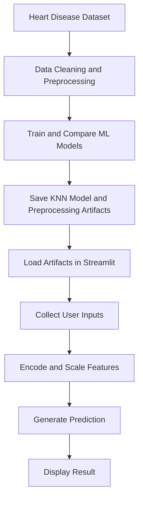

# ❤️ Heart Disease Prediction


An end-to-end machine learning project that estimates the likelihood of heart disease using a trained **K-Nearest Neighbors (KNN)** classifier and an interactive **Streamlit** web application.

## 📌 Overview

I cleaned and preprocessed the dataset in Google Colab, experimented with multiple classification algorithms, and exported the trained model and preprocessing artifacts using Joblib. I then built and refined the Streamlit interface with assistance from Antigravity and OpenCode.

The application allows users to enter patient health attributes and view a model-generated prediction with an estimated probability.

## ✨ Features

- Interactive patient information form
- KNN-based heart disease prediction
- Estimated class probability with a visual result indicator
- Saved scaler and feature-column order for inference
- Clean, healthcare-inspired Streamlit interface
- Medical disclaimer for responsible use

## 🖥️ Application Preview

### Patient Input Interface


### Prediction Results


## ⚙️ How It Works



## 🧰 Tech Stack

| Technology | Purpose |
|---|---|
| Python | Programming language |
| Google Colab | Data cleaning, preprocessing, and model experimentation |
| Pandas | Data manipulation |
| Scikit-learn | Machine learning and feature scaling |
| Joblib | Saving and loading trained artifacts |
| Streamlit | Interactive web application |
| Antigravity and OpenCode | AI-assisted UI development |

## 🩺 Input Features

The application accepts the following patient attributes:

- Age and sex
- Chest pain type
- Resting blood pressure
- Cholesterol
- Fasting blood sugar
- Resting ECG
- Maximum heart rate
- Oldpeak (ST depression)
- Exercise-induced angina
- ST slope

## 📊 Model Evaluation

The following results were recorded in the notebook's model comparison:

| Model | Accuracy | F1-score |
|---|---:|---:|
| Logistic Regression | 85.87% | 87.50% |
| Gaussian Naive Bayes | 86.41% | 87.92% |
| Decision Tree | 79.89% | 82.30% |
| Support Vector Machine (SVM) | 88.04% | 89.62% |
| K-Nearest Neighbors (KNN) | 84.78% | 86.41% |

**Note:** The deployed application uses KNN, although SVM achieved the highest accuracy in the recorded comparison. These results describe the notebook's test split and do not establish clinical validity or guarantee performance on new data.

## 📂 Project Structure

```text
heart-disease-prediction/
├── app.py
├── Heart_disease_datacleaning_preprocessing.ipynb
├── KNN_heart_model.pkl
├── heart_scaler.pkl
├── heart_columns.pkl
├── requirements.txt
├── README.md
└── assets/
    └── app-screenshot.png
```

The three `.pkl` files store the trained model, fitted scaler, and expected feature columns used by the application.

## 🚀 Run Locally

### 1. Clone the repository

```bash
git clone https://github.com/akhil3145/heart-disease-prediction.git
cd heart-disease-prediction
```

### 2. Create a virtual environment

```bash
python -m venv .venv
```

Activate it on Windows:

```powershell
.venv\Scripts\Activate.ps1
```

### 3. Install dependencies

Create a `requirements.txt` file containing the packages used by the application:

```text
streamlit
pandas
scikit-learn
joblib
```

Install them:

```bash
pip install -r requirements.txt
```

For reproducible results, use the tested versions from your development environment.

### 4. Run the application

Make sure `app.py` and all three `.pkl` files are in the same directory.

```bash
streamlit run app.py
```

Open the local URL displayed in the terminal.

## 🔬 Future Improvements

- Add a confusion matrix and detailed classification report.
- Evaluate ROC-AUC and probability calibration.
- Add tests for preprocessing consistency and prediction behavior.
- Record dependency versions for reproducibility.
- Deploy the application and add a live demo link.

## ⚠️ Limitations and Disclaimer

This project is intended for **educational purposes only**. The model's predictions are not medical diagnoses and must not replace professional medical advice.

The displayed probability and risk categories should not be interpreted as clinically validated estimates of an individual's risk of heart disease. Consult a qualified healthcare professional for medical concerns.

## 👨‍💻 Author

**Akhil Pandey**

GitHub: [@akhil3145](https://github.com/akhil3145)

---

If you find this project useful, consider giving the repository a ⭐
